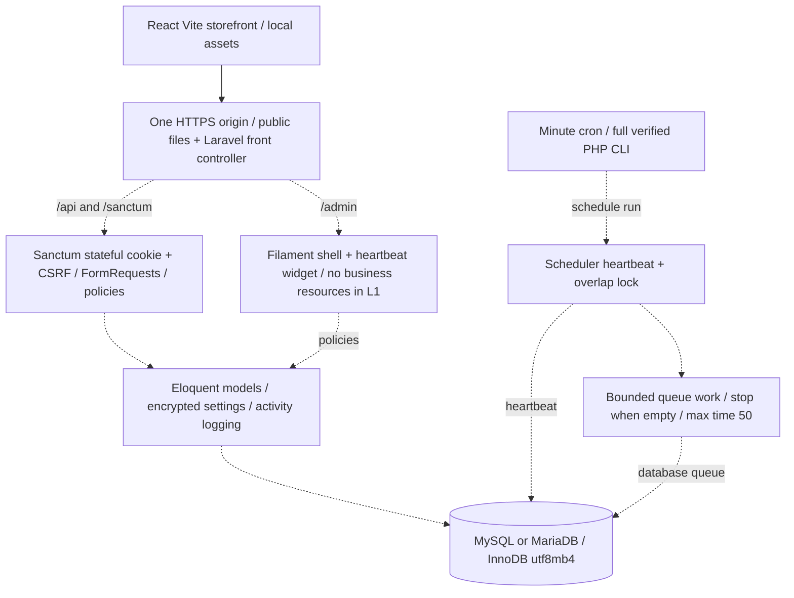

# Architecture — actual state and approved replacement

> **Current 2026-10-21:** full schema and customer/staff authentication/role policies
> now exist. Sanctum transport replaces client JWT refresh; Filament has a gated
> shell/password profile, no resources. See L1_AUTH.md and CI_RESULTS.md for executed
> six-way CI evidence. Earlier L0-only architecture below is historical. Remaining
> settings security/operations are still unimplemented; overall L1 remains incomplete.

> **2026-10-21 update:** GitHub Actions now provides a real PHP8.2/8.3 + MySQL8
> environment. Laravel12/Filament5 were actually Composer-resolved; skeleton and
> initial constrained schema are tested (24 Pest cases). L1 is IN PROGRESS, not
> complete. Older statements below that no Laravel app exists describe the L0
> checkpoint only. See [current CI evidence](CI_RESULTS.md).

2026-10-20. **L0 prepared; L1 not implemented. Launch NO-GO; stop before L2.**
The earlier architecture is preserved in [ARCHITECTURE_LEGACY](ARCHITECTURE_LEGACY.md).
[Specification](SPEC_FROM_LEGACY.md) and [hosting](HOSTING.md) define acceptance.

## Current checkout

Root npm workspaces are `client` and `legacy`. Vite compiles only React storefront;
admin views/layout moved into `legacy/client-admin` and imports/routes removed
from active App. Shared TS contracts are copied, not a Laravel domain implementation.
`legacy/server/index.ts` retains Node server; `legacy/tests` verifies it against
isolated sql.js. It is reference/regression evidence only, never a production
backend. No old DB was deleted or migrated. `backend/README.md` explicitly reserves
an empty application destination. No PHP runtime/vendor is checked into Git.

The frontend is not switched to Sanctum yet: legacy cookie refresh transport and
many catalog/account demo fallbacks remain. It cannot be called a Laravel integration
or trusted checkout. Static fonts/icons are local; image placeholders are explicit.
Future dynamic media/localStorage must also be constrained to safe local paths.

## Target (all dashed boundary components below are outstanding)

Laravel 12 retains PHP 8.2 minimum, target 8.3; latest Laravel 13 cannot meet that
minimum. Filament 5 root constraints permit the intended pairing; Composer lock
and real compatibility tests still required. No Redis, daemon/Supervisor, Docker,
root or Node on production host. Build off-host, expose only public files, preserve
APP_KEY/private data. Database sessions/queue, file/database cache, safe minute cron.
`--max-time` is not a per-job hard timeout; bounded jobs and overlap/retry tests
are mandatory. All delayed work goes through scheduler/queue.

## Boundaries and change control

L1 must separate HTTP/FormRequests, auth/policies, models/settings encryption,
operational commands/scheduler and isolated tests. Default-deny every model action;
Filament navigation is not a security boundary. Money primitives are integer Toman,
no pricing policy invented. Environment secrets remain private; no frontend provider
keys or direct provider calls. Scheduled heartbeat describes real started/completed
runs; Filament visibility is operationally authorized, never public diagnostics.

L2 domain services/checkout/ledger/gateway/SMS/Filament resources require separate
approval. All legacy financial audit blockers remain. Real MySQL/Pest verification,
PHP version matrix, Sanctum browser integration and host deployment checks cannot
be replaced by passing 171 Node tests. See `backend/README.md` for current blockers.
