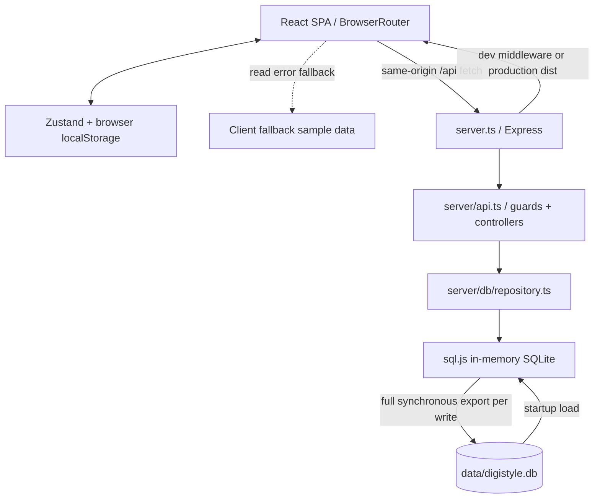

# System architecture

> **L0 migration notice (2026-10-20):** retained historical evidence; old paths now
> map into `legacy/` and `client/`. L0+L1 are authorized, stopping before L2; older
> Phase B wording below is superseded. Laravel L1 is NOT implemented. See
> [current replacement specification](SPEC_FROM_LEGACY.md) and [L0 evidence](L0_RESULTS.md).

> **Historical baseline:** Phase A changed authentication, settings, validation and
> persistence error handling. See [current security contract](SECURITY_FOUNDATION.md)
> and the [audit status update](AUDIT_REPORT.md#phase-a-status-update--2026-10-20).
> Older route line numbers/test outputs below describe the audited baseline.

Phase 2 completed by static code inspection, 2026-10-20. This describes the
implementation, not a desired architecture. Build/runtime outcomes remain
UNVERIFIED until Phase 3. [Discovery](DISCOVERY.md) · [Frontend](FRONTEND.md) ·
[API](API.md) · [Database](DATABASE.md) · [Flows](FLOWS.md) ·
[Settings](SETTINGS.md) · [Payments](PAYMENTS.md) · [SMS](SMS.md)

## System overview

Single-process Express application serving a React SPA, with sql.js SQLite WASM
held in memory and fully exported to a local file after each repository write.
There is no separate server package, ORM, background worker, service bus, SSR,
provider adapter layer, Redis session/OTP store or object storage service.

## Modules and request lifecycle

1. `server.ts` builds Express, wildcard CORS/OPTIONS, JSON/urlencoded body parsers,
   then cookie-parser. No trust-proxy setting or central security/error layer.
2. Database initialization loads/creates schema and optionally seeds sample data
   before listening; persistence and seed share database.ts.
3. `/api` requests enter one router; individual guard functions resolve user from
   bearer/cookie/demo tokens and unsafe admin fallback. Guards are not trustworthy
   authorization boundaries in the current code.
4. Controllers mix HTTP handling, validation, price/stock computation, IDs,
   settings access and activity logging. No service/controller separation.
5. Repositories bind SQL parameters, format rows and save on every execute. Some
   SQL fragments are assembled in code; the later security audit must analyze
   reachable input, not assume parameter binding protects every fragment.
6. Most controller catches return raw error messages as JSON 500. No structured
   domain error model; malformed JSON and unknown routes may be non-JSON.
7. `/health` is liveness only. Development mounts Vite; production serves dist
   with wildcard GET index.html. Build compiles frontend, not backend.

## Folder boundaries

- `src/pages/storefront`, `src/pages/admin`: route views and much business-like
  local UI state. Same frontend bundle; admin is not a separately protected app.
- `src/components/layout`, `src/components/shared`: shells and shared widgets.
- `src/store`: auth/cart/theme/toast stores, mostly browser-local persistence.
- `src/lib`: fetch service/fallback data/Persian utilities.
- `shared/types.ts`: domain interfaces; import sharing does not validate requests.
- `server/api.ts`: all 29 API routes and identity helpers.
- `server/db`: schema/embedded seed and hand-written repositories.
- root config/entry files: scripts, compiler/build/HTML, lockfile and metadata.
- No tracked tests/public/scripts/independent migrations/seed directories.
  [Exact baseline tree](FILE_INVENTORY.md), [versions](DEPENDENCIES.md).

## Data and domain boundaries

Product/category/brand relationships mix scalar IDs and JSON TEXT membership.
Orders snapshot item/address JSON rather than relational order-item rows. All
logical references lack SQL foreign keys. Settings are one unencrypted JSON blob.
Transactions/returns/address/brand tables do not imply implemented workflows.
There is no ledger for wallet debits, provider transaction lifecycle or stock
reservation. Full [DDL inventory and logical ERD](DATABASE.md).

## Cross-cutting decisions actually present

- Authentication: cookie and bearer JWT plus deliberate demo bypasses; client also
  creates demo identities. Admin layout promotes unauthorized state locally.
- Failures: frontend fallback data keeps views populated, obscuring API errors.
- Theming: six CSS variables live-applied to root; publication local to browser.
- Localization: single-language Persian RTL with custom Jalali/digit helpers.
- Providers: settings/UI models only; no payment/SMS network implementation.
- Deployment: one writable local database, frontend dist and TS runtime; no
  checked-in deployment automation. Multi-process correctness is not established.

## Architecture constraints for continuation

Do not add invented gateway interfaces or diagrams representing unimplemented
steps as successful. Reference [actual sequence diagrams](FLOWS.md). Future
provider work needs server-side adapters, amount/currency binding, idempotency and
transactional stock/order transitions, but those are proposals, not existing
capabilities. Detailed fixes and priorities are reserved for Phases 3 and 5.
No application behavior or source files changed during Phase 2.
