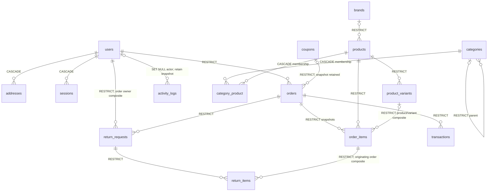

# Database — implemented L1 schema and operational data

2026-10-21. Authoritative source: backend/database/migrations. The full mapping
[LEGACY_SCHEMA_MAP.json](LEGACY_SCHEMA_MAP.json) covers ALL14 legacy tables and175
columns; tests re-read the old DDL and assert actual columns/constraints on real
MySQL8.0/MariaDB10.6/11.4, PHP8.2/8.3. [Evidence](CI_RESULTS.md).
Historical source contract: [DATABASE_LEGACY](DATABASE_LEGACY.md). No production
legacy data has been imported, renamed or deleted by this work.

## Relations

Operational tables: database cache/locks, sessions, password_reset_tokens,
jobs/job_batches/failed_jobs, scheduler_heartbeats. Settings, blog_posts and banners
preserve their mapped legacy columns. No JWT auth_sessions or personal bearer-token
issuance table is an authentication requirement. All18 application models have
explicit default-deny policies; that is not18 exposed business endpoints.

## Invariants tested directly in SQL

InnoDB, utf8mb4_unicode_ci, matching FK column types, required indexes/uniques.
Canonical nonnegative integer **Toman** (not Rial); JS-safe bounds where defined,
positive line quantities, sale <= price, rating/discount/percentage CHECKs, valid
JSON, gateway+authority uniqueness. Ordered products/users and financial history
use RESTRICT, safe dependent addresses/sessions/membership use CASCADE. Composite
FKs prevent cross-product variants, cross-owner returns and unrelated return lines.
SKU namespaces are separately unique in products and product_variants, NOT globally
shared. Legacy string identifiers map explicitly to nullable unique legacy_id or
retained natural keys; no silent integer conversion or importer is implemented.

Laravel timezone UTC and MySQL/MariaDB SESSION time_zone=+00:00 are configured and
asserted in every matrix job. Datetimes are UTC; display/Jalali formatting must not
change storage meaning. Migration down/up is actually tested in an isolated DB.
Never run migrate:fresh/rollback against production; use backups and reviewed
forward migrations. DB constraints do not implement future pricing/stock/payment
transaction workflows.

## L1c/d additions

- settings.value: TEXT with Laravel encrypted cast; service values <=4096 bytes
  before encryption. Constant masked/isSet DTO only. Internal nonsecret bootstrap
  marker is reserved outside the supported credential-key allowlist.
- activity_logs: existing user_id/user_name/user_role/ip_address preserved; new
  JSON before/after complement action/module/subject_id/changed_fields/timestamps.
  Snapshot values default-redact; legacy details remains hidden. No secret copies.
- scheduler_heartbeats: name PK; started_at/completed_at/worker_completed_at and
  worker_failed. `cron` row tracks bounded tick; `queue` row is written only by
  actually processing QueuePulse. Age >3min, missing/future heartbeat or worker
  failure warns. Database queue/cache mutexes need no Redis or new daemon.

Encrypted settings/DB backups are not sufficient without the retained APP_KEY.
No live DB dump, sensitive seed, host test data or release ZIP is committed. The
package smoke adds a temporary probe migration ONLY after extracting the ZIP into
an ephemeral CI directory/database, never to the deliverable schema.

## L2 financial migration / implemented primitives (IN PROGRESS)

Migration `2026_10_21_000005_add_financial_core` is executed on the full matrix.
The historical14/175 mapping above is NOT a count of the expanded financial schema.

- products/product_variants: UTC sale/flash windows, flash price bounded by regular,
  integer grams and nullable quantity caps. Addresses: explicit nullable zone_code;
  missing/unknown zone does not invent a shipping tariff.
- coupons: starts_at, per_user_limit, explicit auto-stacking flag and four JSON
  include/exclude product/category scopes. Capacity CHECK used_count<=usage_limit.
- orders: unique user/idempotency key +intent hash, separate payment_state,
  payable_total, expiry/release/paid/refunded timestamps, pricing_snapshot/receipt path.
  order_items: integer line_total and tax_amount alongside immutable-by-contract
  snapshots. Creation/state/snapshot services still pending; schema is not a workflow.
- coupon_usages: one/order, owner/coupon FKs RESTRICT, reserved/redeemed/released states,
  indexed coupon/user/state. Atomic reserve/release/redemption logic still pending.
- wallet_entries: signed nonzero bounded integer delta; credit/payment/refund/opening,
  unique idempotency key and unique order/kind. UPDATE/DELETE SQL triggers reject
  mutation. Positive preexisting users.wallet_balance migrated as opening entries;
  legacy column rejects edits and nonzero new-user inserts. It is NOT a balance cache.
  Live balance is SUM(delta); User accessor and auth DTO use Ledger. Credits/debits
  and refunds serialize on user locks, current locking SUM, checked nonnegative funds
  and aggregate bounds. End-to-end lifecycle and parallel-spend proof remain pending.
- carts: nullable unique owner or nullable unique SHA256 token hash, optimistic version.
  cart_items: unique cart/product/variant identity, positive qty, composite variant
  ownership FK; no price column. Guest token random256-bit, never stored plaintext.
  Login conflict rolls back complete merge; both carts and versions remain unchanged.

Ledger triggers require the host's TRIGGER privilege; actual host privilege and web/
CLI equivalence remain UNVERIFIED. Do not disable append-only constraints to deploy.
Financial down-migration refuses to erase actual financial orders/nonopening entries;
use forward repairs after commerce begins, not destructive rollback. Do not import
old balances a second time or set users.wallet_balance as an operational shortcut.

## Implemented L2 financial persistence
Migrations000005/000006 are additive; no production legacy import has run.
`carts/cart_items` persist canonical IDs/quantities and optimistic versions; guest
tokens are random secrets stored only as hashes. `wallet_entries` is append-only
signed integer Toman; SUM(delta), not the legacy balance snapshot, is authoritative.
`coupon_usages` state reserved/redeemed/released serializes capacity under coupon
lock. Reserved unpaid orders count toward global/per-user capacity; paid usage is
retained after refund. Unique order/idempotency references prohibit replay effects.
`orders` retains immutable owned-address/quote/monetary/intent snapshots and separate
fulfillment/payment states. `order_items` retains title/SKU/unit/discount/tax/line
and signed adjustment data. Live catalog edits cannot rewrite these snapshots.
`order_events` retains actor snapshot, transition/reason/time; SQL rejects UPDATE/
DELETE. SQL snapshot triggers apply to new idempotency-key orders; legacy null-key
orders require administrator review and are not mutated by the new lifecycle.
Stock is reserved on creation and released once, not deducted again when paid.
COD expires_at is null; cod_review_at defaults7days and cod_flagged_at warns only.
Other unpaid/pending-verification expiry defaults30min. All instants persist UTC.
Cross-row money equality is enforced transactionally by domain services, not by
pretending a CHECK constraint can inspect other tables. Six real database/PHP CI
jobs cover constraints, rollback, triggers, races and no-dev migration smoke.
Host restore/import/large-dataset performance remain UNVERIFIED.

## L3a shell slice (in progress)
No schema or production data changes in this concern. Heartbeat reads existing
scheduler_heartbeats with2 bounded queries. Stock adjustment history, soft-deleted
catalog relations, attribute terms and media usage schema are still pending L3a.
Do not infer stock-ledger/media-library existence from the existing stock counters
or safe upload primitive. ADMIN_PANEL.md records each unimplemented action.

## L3a category editor foundation (verified CI39734575452/39734581936)

Migration2026_10_22_000001 adds nullable category meta_title160/meta_description320
and an order_index/id pagination index. `catalog_locks` contains the seeded
`taxonomy` mutex row, locked in each category mutation transaction after fresh
actor authorization. It serializes reparent/reorder/delete validation; existing
category parent FK and unique slug remain authoritative. No stock/financial schema
changed. Category delete currently guarded hard delete; product soft deletion is
not implemented by this migration. Panel category editor is wired and runtime-tested; visual/browser/host checks remain UNVERIFIED.

## L3a attribute/term foundation (new runtime pending)

Migration2026_10_22_000002 adds catalog_attributes (unique slug, enum type),
attribute_terms (owner-scoped unique slug, nullable canonical hex/image, order index)
and product_attribute_terms. Terms use an actual SQL hex-format CHECK. The product
pivot's composite (term_id,attribute_id) FK prevents attributing another owner's
term to a product, and referenced term/product deletion is restricted. Root and
term mutations share the existing taxonomy serialization mutex; no stock or
financial columns changed. No product assignment screen exists in this sub-step.

## L3a product metadata foundation — runtime pending

Migration2026_10_22_000003 adds nullable Gregorian UTC published_at, SEO fields,
soft deleted_at and publication index. New editorial state refuses destructive
rollback. Root identifiers remain reserved while trashed; all pivots/FKs remain.
Existing sale/flash TIMESTAMP fields are retained; editor-service dates explicitly
bound to1970-01-02 inclusive through2038-01-19 exclusive for all SQL versions.
Scheduled status becomes effectively visible at published_at without rewriting
status. Both public catalog and authoritative pricing reject trashed/not-yet-live
products. No monetary/stock schema, ledger or financial calculation changed.
