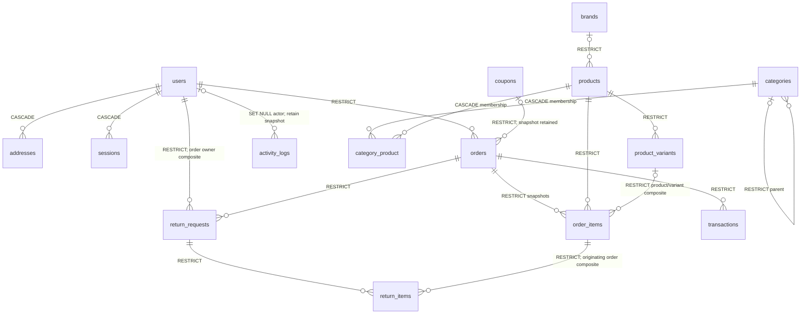

# Database — implemented L1 schema and operational data

2026-10-21. Authoritative source: backend/database/migrations. The full mapping
[LEGACY_SCHEMA_MAP.json](LEGACY_SCHEMA_MAP.json) covers ALL14 legacy tables and175
columns; tests re-read the old DDL and assert actual columns/constraints on real
MySQL8.0/MariaDB10.6/11.4, PHP8.2/8.3. [Evidence](CI_RESULTS.md).
Historical source contract: [DATABASE_LEGACY](DATABASE_LEGACY.md). No production
legacy data has been imported, renamed or deleted by this work.

## Relations

Operational tables: database cache/locks, sessions, password_reset_tokens,
jobs/job_batches/failed_jobs, scheduler_heartbeats. Settings, blog_posts and banners
preserve their mapped legacy columns. No JWT auth_sessions or personal bearer-token
issuance table is an authentication requirement. All18 application models have
explicit default-deny policies; that is not18 exposed business endpoints.

## Invariants tested directly in SQL

InnoDB, utf8mb4_unicode_ci, matching FK column types, required indexes/uniques.
Canonical nonnegative integer **Toman** (not Rial); JS-safe bounds where defined,
positive line quantities, sale <= price, rating/discount/percentage CHECKs, valid
JSON, gateway+authority uniqueness. Ordered products/users and financial history
use RESTRICT, safe dependent addresses/sessions/membership use CASCADE. Composite
FKs prevent cross-product variants, cross-owner returns and unrelated return lines.
SKU namespaces are separately unique in products and product_variants, NOT globally
shared. Legacy string identifiers map explicitly to nullable unique legacy_id or
retained natural keys; no silent integer conversion or importer is implemented.

Laravel timezone UTC and MySQL/MariaDB SESSION time_zone=+00:00 are configured and
asserted in every matrix job. Datetimes are UTC; display/Jalali formatting must not
change storage meaning. Migration down/up is actually tested in an isolated DB.
Never run migrate:fresh/rollback against production; use backups and reviewed
forward migrations. DB constraints do not implement future pricing/stock/payment
transaction workflows.

## L1c/d additions

- settings.value: TEXT with Laravel encrypted cast; service values <=4096 bytes
  before encryption. Constant masked/isSet DTO only. Internal nonsecret bootstrap
  marker is reserved outside the supported credential-key allowlist.
- activity_logs: existing user_id/user_name/user_role/ip_address preserved; new
  JSON before/after complement action/module/subject_id/changed_fields/timestamps.
  Snapshot values default-redact; legacy details remains hidden. No secret copies.
- scheduler_heartbeats: name PK; started_at/completed_at/worker_completed_at and
  worker_failed. `cron` row tracks bounded tick; `queue` row is written only by
  actually processing QueuePulse. Age >3min, missing/future heartbeat or worker
  failure warns. Database queue/cache mutexes need no Redis or new daemon.

Encrypted settings/DB backups are not sufficient without the retained APP_KEY.
No live DB dump, sensitive seed, host test data or release ZIP is committed. The
package smoke adds a temporary probe migration ONLY after extracting the ZIP into
an ephemeral CI directory/database, never to the deliverable schema.
