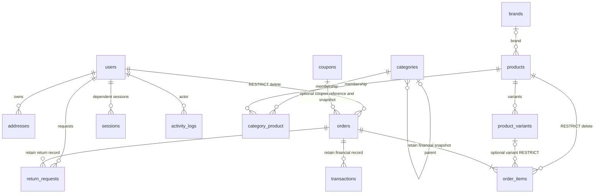

# Database contract — target ER, not migrated schema

2026-10-20. **No Laravel migrations or MySQL database have been created/tested yet.**
Exact historical 14-table/175-column inventory is preserved in
[DATABASE_LEGACY](DATABASE_LEGACY.md). Phase A additionally introduced auth_sessions;
its JWT schema will not be carried into Sanctum as an auth design. The following
is the required L1 design, subject to ordered migrations and real constraint tests.

## Proposed normalized relations

`users` remain the authentication/customer parent; do not create an unrelated
customer identity. Customer profile separation, if needed later, must use a unique
user FK. Preserve immutable order/customer/address/item snapshots separately from
live entities. Avoid duplicating financial authority in an editable JSON field.

Settings, blog_posts, banners and operational jobs/failed_jobs/cache/heartbeat tables
are standalone or have explicit optional author relations. Role/permission pivots
or equivalent roles with validated policy coverage are added in L1. ER cardinality
is a business contract, **not evidence that MySQL enforces it today**.

## Migration ordering / constraints

1. Identity + role/permission foundations; cache/session/queue/heartbeat tables.
2. Category self-reference, brands; products; product variants; category_product.
3. Addresses, coupons; orders with customer FK/snapshots; order_items with product
   and optional variant FKs; transactions and returns.
4. Settings, content/banners, activity logs; indexes/checks before app exposure.
   Reverse dependencies in down migrations; test migrate/rollback/migrate on an
   isolated database. Never run destructive rollback/fresh on production.

InnoDB, explicit utf8mb4 collation (test Persian/case uniqueness behavior), matching
FK column types. IDs/normalization choices must be encoded consistently in actual
migrations rather than assumed from legacy TEXT IDs. Unique normalized phone and
nullable email; unique per-entity slugs, SKU and coupon code; order_number uniqueness.
Cross-product/variant SKU uniqueness needs a shared registry or another explicit
enforced design if a single global namespace is chosen. Index FK columns and real
lookup/status/time filters, with direct SQL metadata assertions.

Use nonnegative integer Toman (document maximum; JS-safe DTO amounts or exact string
transport), unsigned/check stock and quantity; sale_price <= price; quantity > 0,
percent/rating bounds. SQL modes and server version must enforce checks — not merely
parse them. Require MySQL >=8.0.16 or an explicitly tested current MariaDB release;
exact host version remains unverified. Store UTC timestamps, no localized strings.

**RESTRICT:** order_items→products and optional variants, orders→users, financial
children→orders. Archive/soft-delete instead of cascading order/payment evidence.
Category children/brand references need RESTRICT or nullable SET NULL with deliberate
semantics. CASCADE only proven-safe dependent nonfinancial rows/pivots/sessions;
address cascade is safe only when orders retain snapshots and no other reference
needs the live address. Add return-line normalization in the approved returns phase,
not a fake financial implementation. Schema preparation does not authorize services.

Settings use encrypted casts (APP_KEY outside DB) and explicit masked DTOs. Direct
DB tests must prove no secret plaintext; API and audit-log tests must prove no echo.
Do not migrate historical provider-looking values/default hashes without review.
Dev-only seeders fail closed outside local/testing; production admin bootstrap is
separate, explicit and environment-provisioned, never automatic demo data.

## Required evidence

Real disposable MySQL/MariaDB must reject duplicate email/phone/slugs/SKU/coupon,
orphan FKs, negative quantities/stock/money and deletion of ordered products/customer.
Test nullable uniques, multibyte strings, UTC/Toman round trips, dependency order,
rollback, transaction failure and indexes. Test with direct SQL, not just validation.
No Pest or MySQL constraints have been executed; current 171 sql.js tests do not
count toward this acceptance. See [specification](SPEC_FROM_LEGACY.md).
