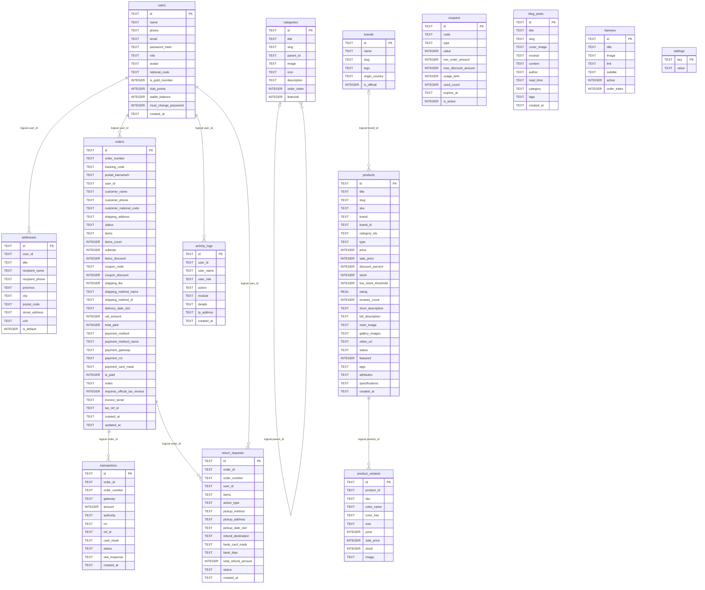

# Database reference

> **L0 migration notice (2026-10-20):** retained historical evidence; old paths now
> map into `legacy/` and `client/`. L0+L1 are authorized, stopping before L2; older
> Phase B wording below is superseded. Laravel L1 is NOT implemented. See
> [current replacement specification](SPEC_FROM_LEGACY.md) and [L0 evidence](L0_RESULTS.md).

> **Historical baseline:** Phase A changed authentication, settings, validation and
> persistence error handling. See [current security contract](SECURITY_FOUNDATION.md)
> and the [audit status update](AUDIT_REPORT.md#phase-a-status-update--2026-10-20).
> Older route line numbers/test outputs below describe the audited baseline.

Phase 2 static source analysis, 2026-10-20. Source: `server/db/database.ts:58–273`. Runtime database inspection remains UNVERIFIED. [Architecture](ARCHITECTURE.md) · [API](API.md)

## Storage and lifecycle

`initDatabase()` initializes sql.js, loads `<cwd>/data/digistyle.db` if readable, otherwise creates a new in-memory database. Load failure also falls back to a fresh database. Schema uses CREATE TABLE IF NOT EXISTS; it does not upgrade existing columns. If users count is zero, embedded seed runs and exports the DB. There is no migration version table, rollback framework or independent seed command. `saveDatabase()` exports the full database synchronously; export failures are logged and swallowed. Never commit this data directory.

## Exact declared columns

Definitions below are copied from schema DDL, not inferred from TypeScript. No explicit FOREIGN KEY, CHECK, secondary CREATE INDEX or transaction block exists in the schema. PRIMARY KEY and UNIQUE declarations create SQLite-managed uniqueness indexes. TEXT PRIMARY KEY does not by itself mean an explicit NOT NULL declaration in this DDL. SQLite declared types are affinities, not strict runtime schemas.

### `users`

| Column | Type | Declared constraints/default |
|---|---|---|
| `id` | TEXT | PRIMARY KEY |
| `name` | TEXT | NOT NULL |
| `phone` | TEXT | UNIQUE NOT NULL |
| `email` | TEXT | — |
| `password_hash` | TEXT | NOT NULL |
| `role` | TEXT | NOT NULL |
| `avatar` | TEXT | — |
| `national_code` | TEXT | — |
| `is_gold_member` | INTEGER | DEFAULT 0 |
| `club_points` | INTEGER | DEFAULT 0 |
| `wallet_balance` | INTEGER | DEFAULT 0 |
| `must_change_password` | INTEGER | DEFAULT 0 |
| `created_at` | TEXT | NOT NULL |

### `addresses`

| Column | Type | Declared constraints/default |
|---|---|---|
| `id` | TEXT | PRIMARY KEY |
| `user_id` | TEXT | NOT NULL |
| `title` | TEXT | NOT NULL |
| `recipient_name` | TEXT | NOT NULL |
| `recipient_phone` | TEXT | NOT NULL |
| `province` | TEXT | NOT NULL |
| `city` | TEXT | NOT NULL |
| `postal_code` | TEXT | NOT NULL |
| `street_address` | TEXT | NOT NULL |
| `unit` | TEXT | — |
| `is_default` | INTEGER | DEFAULT 0 |

### `categories`

| Column | Type | Declared constraints/default |
|---|---|---|
| `id` | TEXT | PRIMARY KEY |
| `title` | TEXT | NOT NULL |
| `slug` | TEXT | UNIQUE NOT NULL |
| `parent_id` | TEXT | — |
| `image` | TEXT | — |
| `icon` | TEXT | — |
| `description` | TEXT | — |
| `order_index` | INTEGER | DEFAULT 0 |
| `featured` | INTEGER | DEFAULT 0 |

### `brands`

| Column | Type | Declared constraints/default |
|---|---|---|
| `id` | TEXT | PRIMARY KEY |
| `name` | TEXT | NOT NULL |
| `slug` | TEXT | UNIQUE NOT NULL |
| `logo` | TEXT | — |
| `origin_country` | TEXT | — |
| `is_official` | INTEGER | DEFAULT 1 |

### `products`

| Column | Type | Declared constraints/default |
|---|---|---|
| `id` | TEXT | PRIMARY KEY |
| `title` | TEXT | NOT NULL |
| `slug` | TEXT | UNIQUE NOT NULL |
| `sku` | TEXT | UNIQUE NOT NULL |
| `brand` | TEXT | NOT NULL |
| `brand_id` | TEXT | — |
| `category_ids` | TEXT | NOT NULL |
| `type` | TEXT | NOT NULL |
| `price` | INTEGER | NOT NULL |
| `sale_price` | INTEGER | — |
| `discount_percent` | INTEGER | — |
| `stock` | INTEGER | NOT NULL |
| `low_stock_threshold` | INTEGER | DEFAULT 5 |
| `rating` | REAL | DEFAULT 5.0 |
| `reviews_count` | INTEGER | DEFAULT 0 |
| `short_description` | TEXT | — |
| `full_description` | TEXT | NOT NULL |
| `main_image` | TEXT | NOT NULL |
| `gallery_images` | TEXT | NOT NULL |
| `video_url` | TEXT | — |
| `status` | TEXT | NOT NULL |
| `featured` | INTEGER | DEFAULT 0 |
| `tags` | TEXT | NOT NULL |
| `attributes` | TEXT | NOT NULL |
| `specifications` | TEXT | NOT NULL |
| `created_at` | TEXT | NOT NULL |

### `product_variants`

| Column | Type | Declared constraints/default |
|---|---|---|
| `id` | TEXT | PRIMARY KEY |
| `product_id` | TEXT | NOT NULL |
| `sku` | TEXT | NOT NULL |
| `color_name` | TEXT | — |
| `color_hex` | TEXT | — |
| `size` | TEXT | — |
| `price` | INTEGER | NOT NULL |
| `sale_price` | INTEGER | — |
| `stock` | INTEGER | NOT NULL |
| `image` | TEXT | — |

### `orders`

| Column | Type | Declared constraints/default |
|---|---|---|
| `id` | TEXT | PRIMARY KEY |
| `order_number` | TEXT | UNIQUE NOT NULL |
| `tracking_code` | TEXT | NOT NULL |
| `postal_barnameh` | TEXT | — |
| `user_id` | TEXT | NOT NULL |
| `customer_name` | TEXT | NOT NULL |
| `customer_phone` | TEXT | NOT NULL |
| `customer_national_code` | TEXT | — |
| `shipping_address` | TEXT | NOT NULL |
| `status` | TEXT | NOT NULL |
| `items` | TEXT | NOT NULL |
| `items_count` | INTEGER | NOT NULL |
| `subtotal` | INTEGER | NOT NULL |
| `items_discount` | INTEGER | NOT NULL |
| `coupon_code` | TEXT | — |
| `coupon_discount` | INTEGER | DEFAULT 0 |
| `shipping_fee` | INTEGER | DEFAULT 0 |
| `shipping_method_name` | TEXT | NOT NULL |
| `shipping_method_id` | TEXT | NOT NULL |
| `delivery_date_slot` | TEXT | NOT NULL |
| `vat_amount` | INTEGER | DEFAULT 0 |
| `total_paid` | INTEGER | NOT NULL |
| `payment_method` | TEXT | NOT NULL |
| `payment_method_name` | TEXT | NOT NULL |
| `payment_gateway` | TEXT | — |
| `payment_rrn` | TEXT | — |
| `payment_card_mask` | TEXT | — |
| `is_paid` | INTEGER | DEFAULT 0 |
| `notes` | TEXT | — |
| `requires_official_tax_invoice` | INTEGER | DEFAULT 0 |
| `invoice_serial` | TEXT | — |
| `tax_ref_id` | TEXT | — |
| `created_at` | TEXT | NOT NULL |
| `updated_at` | TEXT | NOT NULL |

### `coupons`

| Column | Type | Declared constraints/default |
|---|---|---|
| `id` | TEXT | PRIMARY KEY |
| `code` | TEXT | UNIQUE NOT NULL |
| `type` | TEXT | NOT NULL |
| `value` | INTEGER | NOT NULL |
| `min_order_amount` | INTEGER | DEFAULT 0 |
| `max_discount_amount` | INTEGER | — |
| `usage_limit` | INTEGER | — |
| `used_count` | INTEGER | DEFAULT 0 |
| `expires_at` | TEXT | — |
| `is_active` | INTEGER | DEFAULT 1 |

### `blog_posts`

| Column | Type | Declared constraints/default |
|---|---|---|
| `id` | TEXT | PRIMARY KEY |
| `title` | TEXT | NOT NULL |
| `slug` | TEXT | UNIQUE NOT NULL |
| `cover_image` | TEXT | NOT NULL |
| `excerpt` | TEXT | NOT NULL |
| `content` | TEXT | NOT NULL |
| `author` | TEXT | NOT NULL |
| `read_time` | TEXT | NOT NULL |
| `category` | TEXT | NOT NULL |
| `tags` | TEXT | NOT NULL |
| `created_at` | TEXT | NOT NULL |

### `banners`

| Column | Type | Declared constraints/default |
|---|---|---|
| `id` | TEXT | PRIMARY KEY |
| `title` | TEXT | NOT NULL |
| `image` | TEXT | NOT NULL |
| `link` | TEXT | NOT NULL |
| `subtitle` | TEXT | — |
| `active` | INTEGER | DEFAULT 1 |
| `order_index` | INTEGER | DEFAULT 0 |

### `activity_logs`

| Column | Type | Declared constraints/default |
|---|---|---|
| `id` | TEXT | PRIMARY KEY |
| `user_id` | TEXT | NOT NULL |
| `user_name` | TEXT | NOT NULL |
| `user_role` | TEXT | NOT NULL |
| `action` | TEXT | NOT NULL |
| `module` | TEXT | NOT NULL |
| `details` | TEXT | NOT NULL |
| `ip_address` | TEXT | — |
| `created_at` | TEXT | NOT NULL |

### `settings`

| Column | Type | Declared constraints/default |
|---|---|---|
| `key` | TEXT | PRIMARY KEY |
| `value` | TEXT | NOT NULL |

### `transactions`

| Column | Type | Declared constraints/default |
|---|---|---|
| `id` | TEXT | PRIMARY KEY |
| `order_id` | TEXT | NOT NULL |
| `order_number` | TEXT | NOT NULL |
| `gateway` | TEXT | NOT NULL |
| `amount` | INTEGER | NOT NULL |
| `authority` | TEXT | — |
| `rrn` | TEXT | — |
| `ref_id` | TEXT | — |
| `card_mask` | TEXT | — |
| `status` | TEXT | NOT NULL |
| `raw_response` | TEXT | — |
| `created_at` | TEXT | NOT NULL |

### `return_requests`

| Column | Type | Declared constraints/default |
|---|---|---|
| `id` | TEXT | PRIMARY KEY |
| `order_id` | TEXT | NOT NULL |
| `order_number` | TEXT | NOT NULL |
| `user_id` | TEXT | NOT NULL |
| `items` | TEXT | NOT NULL |
| `action_type` | TEXT | NOT NULL |
| `pickup_method` | TEXT | NOT NULL |
| `pickup_address` | TEXT | NOT NULL |
| `pickup_date_slot` | TEXT | NOT NULL |
| `refund_destination` | TEXT | NOT NULL |
| `bank_card_mask` | TEXT | — |
| `bank_iban` | TEXT | — |
| `total_refund_amount` | INTEGER | NOT NULL |
| `status` | TEXT | NOT NULL |
| `created_at` | TEXT | NOT NULL |

## Logical relations (not enforced foreign keys)

Every edge below is a logical application association only. JSON category membership and order items are not join-table/FK relations; bank/card fields in returns are data, not payment integrations.

## Embedded JSON and domain mapping

Products encode category_ids, gallery_images, tags, attributes and specifications as JSON TEXT. Orders encode shipping_address and items as JSON snapshots. Blog tags and return items are JSON-shaped fields. `settings` stores one general row with the complete settings object. Booleans use INTEGER flags, money uses INTEGER and dates use TEXT (usually ISO strings from JavaScript); no SQL timezone or currency constraint is present.

## Repository/data-access layer

`server/db/repository.ts:8–29`: prepared/bound query helpers; execute runs SQL then saves the entire DB. No unit-of-work/transaction abstraction. SQL result formatters map snake_case to camelCase, convert booleans/numbers, and parse JSON. Product mapping queries variants per product (N+1 shape); order mapping includes fallback title/image normalization.

| Repository | Methods / scope |
|---|---|
| usersRepo | findById, findRawByPhoneOrEmailOrAdmin, findRawById, list, create, update; sanitized API shape omits password_hash |
| productsRepo | list, findById, findBySlug, create, update, delete; create inserts variants separately; update does not update variants/attributes/brandId/type/tags |
| categoriesRepo | list and findById; snake_case category mapping, no computed productCount |
| ordersRepo | list, findById, findByTrackingCode, create, update; update only status/tracking/postal/isPaid and timestamp |
| couponsRepo | findByCode, list; no redemption counter update |
| bannersRepo | active ordered list; raw DB keys |
| blogsRepo | list and findBySlug; no write API |
| settingsRepo | get general JSON and shallow merge update |
| logsRepo | add and list (default 100) |

No dedicated repository/API found for addresses, brands, transactions or return_requests despite schema presence. Product delete removes product then variants as separate saved statements, without order-snapshot protection. Product creation, order stock changes, order insertion and logging are not atomic. Seed data lives inside database.ts; it is sample content, not a migration system.
