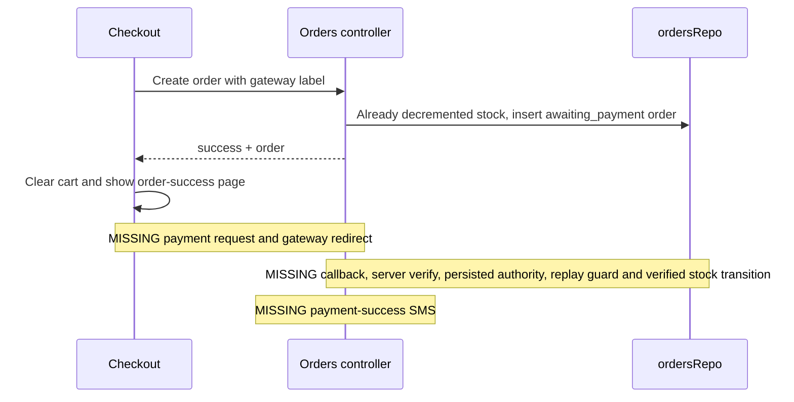
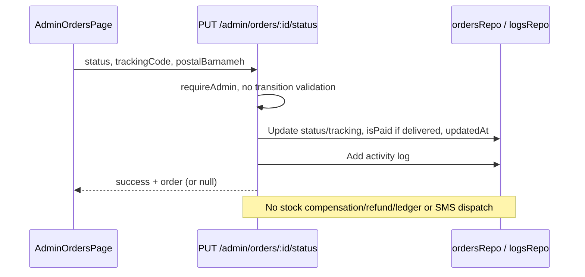
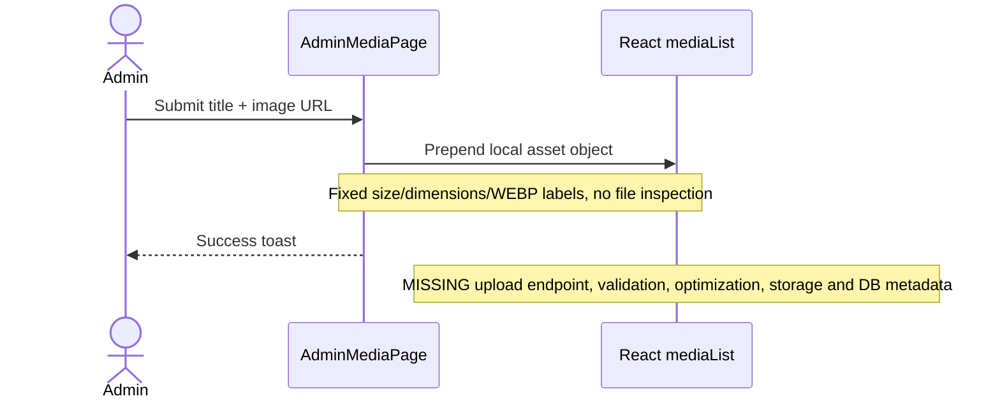
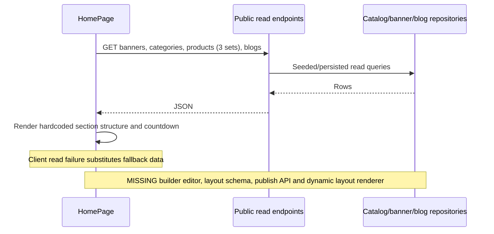

# Core flows — actual sequences and explicit gaps

Phase 2 static inspection, 2026-10-20. [Architecture](ARCHITECTURE.md) ·
[API](API.md) · [Database](DATABASE.md). Diagrams describe code paths, NOT successful
runtime/provider tests. Missing integrations are notes, not imaginary participants.

## Authentication, password login and OTP

Sources: `AuthModal.tsx:20–120`, `authStore.ts`, `server/api.ts:15–249`.

```mermaid
sequenceDiagram
    actor U as Visitor
    participant UI as AuthModal / authStore
    participant API as Express auth routes
    participant DB as usersRepo / SQLite
    U->>UI: Password login
    UI->>API: POST /api/auth/login identifier,password
    API->>DB: Find raw user
    DB-->>API: password_hash / identity
    API->>API: bcrypt compare, sign JWT for 7 days
    API-->>UI: user + token + HttpOnly cookie
    UI->>UI: setUser and localStorage token
    Note over UI,API: Missing/invalid credentials on other routes can resolve to admin
    U->>UI: Request OTP
    UI->>API: POST /api/auth/send-otp
    Note over UI,API: WRONG PATH; server implements /api/auth/otp/send
    Note over UI: Non-JSON/network exception triggers fake demo-send UI
    UI->>API: POST /api/auth/verify-otp
    Note over UI,API: WRONG PATH; server implements /api/auth/otp/verify
    Note over API: Actual send stores fixed code + expires in process memory, no SMS
    Note over API,DB: Actual verify checks code but not expiry; consumes record, may create customer, signs JWT
```

Registration calls the correct route and hashes supplied password; no strength
validation. Server OTP auto-registration uses a fixed default password (masked).
Change-password checks old password only when supplied. `/auth/me` without a
header/cookie returns null; client without local token uses demo customer instead
of querying cookies. AdminLayout promotes non-admin state to synthetic admin and
stores a recognized demo token. This is demo behavior, not a secure login flow.

## Product creation with variations and images

Sources: `AdminProductsPage.tsx:53–112`, `server/api.ts:723–774`,
`server/db/repository.ts:215–308`.

```mermaid
sequenceDiagram
    actor A as Admin UI user
    participant UI as AdminProductsPage
    participant API as Product controller
    participant Repo as productsRepo
    participant DB as SQLite + disk export
    A->>UI: Enter product fields and image URL
    UI->>API: POST /api/admin/products
    API->>API: requireAdmin (unsafe fallback), generate id/sku/time
    API->>Repo: create(body)
    Repo->>DB: Insert product, JSON fields; export
    loop Supplied variants (API supports them; UI lacks complete editor)
        Repo->>DB: Insert variant; export separately
    end
    Note over Repo,DB: No transaction; later variant failure can leave partial product
    API->>DB: Activity log insert + export
    API-->>UI: success + submitted product
    Note over UI,DB: Images are URLs; no upload or optimization pipeline
```

Update persists only whitelisted scalar/JSON fields; ignores variants/attributes
and several other Product fields. Product deletion and variant deletion are two
separate exports. Product lists query variants once per product.

## Cart, checkout and order creation

Sources: `cartStore.ts:102–330`, `CheckoutPage.tsx:44–101`,
`server/api.ts:450–603`, `ordersRepo`.

```mermaid
sequenceDiagram
    actor C as Customer
    participant UI as Cart / CheckoutPage
    participant Cart as cartStore + localStorage
    participant API as POST /api/orders
    participant DB as Repositories / SQLite
    C->>Cart: Add items, quantities and selected variant
    Cart->>Cart: Save item snapshots in localStorage
    UI->>API: Client item snapshots + recipient + paymentMethod
    API->>API: Minimal truthiness checks; resolve user (defaults admin)
    loop Each supplied item
        API->>DB: Read product by supplied productId
        API->>API: Prefer supplied item/variant prices, accumulate totals
        API->>DB: Update base product stock, clamp to zero; export
    end
    API->>DB: Read general settings and optional coupon
    API->>API: Compute shipping, coupon, VAT and total
    API->>DB: Insert order snapshot + export
    API->>DB: Insert activity log + export
    API-->>UI: Order JSON (not payment confirmation)
    UI->>Cart: Clear cart
    UI->>UI: Navigate directly to /order-success/:id
    Note over API,DB: No stock reservation/transaction, no variant decrement, no gateway verification
```

### Calculation boundaries (not a single authoritative pricing service)

- Cart effective unit price: variant salePrice → variant price → item salePrice →
  item price, using `||` (zero treated as absent). Quantity multiplies unit value.
- Cart percent coupon rounds then caps at maxDiscountAmount; fixed coupon uses
  value. Validation uses API but store initially contains a demo fixed coupon.
- Cart shipping: subtotal >=4,000,000 OR zero → free, otherwise 45,000.
- Checkout recomputes percent coupon WITHOUT max cap; express shipping=65,000,
  standard from cart helper. total=max(0,subtotal-coupon+shipping).
- Server original unit: item.price → nested product.price → DB price → 0.
  Current unit: supplied variant salePrice/price → item salePrice → supplied
  product salePrice/price → DB salePrice/price → original. All use `||`.
- Server shipping threshold defaults 5,000,000, standard=49,000, express=95,000;
  reads nullish settings overrides. Threshold applies to pre-coupon subtotal.
- Server coupon: active + minimum; percentage Math.round with optional maximum
  cap or fixed amount. No expiration, usage-limit enforcement or redemption count.
- vatAmount=round(subtotal*vatPercent/100), default 10. totalPaid is
  max(0,subtotal-couponDiscount+shippingFee): VAT is recorded but not added.
- itemsDiscount is informational original-current difference, not subtracted again.
- `cod`: status processing, isPaid=true; `wallet`: awaiting_payment yet isPaid=true
  without ledger/debit. Others awaiting_payment and unpaid.

Currency display is Toman; no verified Rial conversion. Negative quantities,
trusted prices, rounding/tax policy and concurrency require Phase 3 findings.

## Payment request, redirect, callback and verification

Sources: `CheckoutPage.tsx:94–97`, `server/api.ts:570–577`; [Payments](PAYMENTS.md).



There is no implemented gateway endpoint/error-code map or double-verification
protection to describe; a transactions table alone does not implement these steps.

## Order status change and notification



Sources: `AdminOrdersPage.tsx:47–61`, `server/api.ts:811–835`.

## Theme change and live apply

```mermaid
sequenceDiagram
    actor A as Theme editor
    participant UI as AdminThemePage
    participant Store as themeStore
    participant DOM as document.documentElement
    participant LS as Browser localStorage
    A->>UI: Change color or preset
    UI->>Store: setDraftColor
    Store->>DOM: Set six primary/secondary/tertiary CSS variables
    A->>UI: Publish
    UI->>Store: publishTheme
    Store->>LS: Save digistyle_custom_theme
    Store->>DOM: Apply same six variables
    Note over Store,LS: No API/global publication; background/surface/radius not applied
    Note over DOM: Storefront route effect initTheme restores saved colors
```

Sources: `AdminThemePage.tsx:80–101`, `themeStore.ts:62–121`.

## Media entry and missing optimization



Source: `AdminMediaPage.tsx:125–151`. No real upload → optimization sequence exists.

## Coupon validation and discount calculation

```mermaid
sequenceDiagram
    participant UI as Cart UI
    participant Store as cartStore
    participant API as POST /coupons/validate
    participant DB as couponsRepo
    UI->>Store: applyCoupon(code)
    Store->>API: code, client subtotal
    API->>DB: Case-insensitive code lookup
    API->>API: Active + minimum check; percent round/cap or fixed
    API-->>Store: coupon + computed discount
    Store->>Store: Store coupon, locally recompute discount
    Note over Store,API: Checkout and order independently recalculate; no shared pricing contract
    Note over API,DB: No expires_at, usage_limit or used_count enforcement/update
```

Sources: `cartStore.ts:250–315`, `server/api.ts:404–443,526–540`.

## Home content and missing home builder



Sources: `HomePage.tsx:13–45`, `AdminMarketingPage.tsx` local banner state. Editing
marketing demo banners does not update the banners repository used by HomePage.
