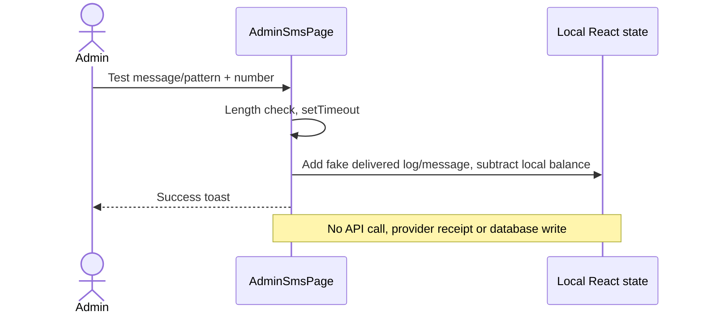

# SMS architecture — simulation versus delivery

Phase 2 static inspection, 2026-10-20. [API](API.md) · [Flows](FLOWS.md) ·
[Settings](SETTINGS.md)

## What is implemented

`AdminSmsPage.tsx:123–212` holds provider, API key/sender-looking fields, patterns,
balance, simulated messages and logs in local React state. Provider choices include
Kavenegar, Melipayamak and FarazSMS. Save-provider handler displays a success toast
without a persistence/network call. Test-send uses setTimeout then creates a fake
"delivered" log, invented trace ID and balance debit; it does not send an SMS.
Patterns and logs are initial arrays/local edits, not server templates or receipts.
No credential values are reproduced here; real validity remains UNVERIFIED.

Server OTP endpoints (`server/api.ts:121–192`) store a predictable fixed code in a
process-local object with an expiry timestamp. Verification never checks expiry,
only equality, then deletes the record and optionally registers a customer.
No provider dispatch, attempt limiter, resend throttle or cross-process store.
AuthModal calls different OTP URL paths than the implemented endpoints; see
[frontend](FRONTEND.md) and [auth sequence](FLOWS.md#authentication-password-login-and-otp).

## Adapter and provider inventory

| Area | Actual implementation |
|---|---|
| Shared SMS adapter interface | MISSING |
| Melipayamak server implementation | MISSING; nested settings field is not delivery |
| Faraz server implementation | MISSING; UI choice only |
| Kavenegar server implementation | MISSING; UI/type/seed config does not dispatch |
| Provider config modules / endpoint and error maps | MISSING |
| Encrypted credentials | MISSING; general JSON settings unencrypted |
| Template resolver and durable SMS job queue | MISSING |
| Delivery receipt webhook / retries | MISSING |
| Durable SMS logs | MISSING; UI simulator logs are local |
| Order create/status/payment SMS trigger | MISSING; controllers write activity logs only |

GET settings masks only nested sms.melipayamak.apiKey; other values and PUT response
are not comprehensively masked. Admin demo configuration and general settings are
separate surfaces. See [settings propagation](SETTINGS.md).

## Sequence: simulator (not provider transport)

## Future extension and validation gates

There is no current interface to extend or runnable provider sandbox procedure.
Proposed only (requires approval): server sendOtp/sendTemplate/sendText adapter,
provider-specific mapping and normalized errors, protected credentials, secure
random one-use OTP with expiry/attempt enforcement, durable audit/queue/retry,
idempotent event-triggered sends and sensitive-data redaction. Client components
must never call providers or receive provider keys.

Official provider endpoints, pattern formats, template IDs, error codes, sandbox
support, Iranian sender/hosting/IP policies are **UNVERIFIED**; official provider
hosts are outside sandbox outbound allowlist. Before go-live, validate current
contracts, consent/sender requirements, success/rejection/timeout/rate-limit paths,
OTP expiry/replay and duplicate events with test credentials. No real message has
been sent in this audit. Full operational reference remains Phase 4 work.
